<p align="center">
  
</p>

### AI Engineer

Building my skills through real projects focused on **AI Engineer, Full Stack Development, APIs, AI applications, automation, and software engineering practices**.

I enjoy understanding how systems work end to end — from the user interface and business logic to APIs, data persistence, and AI agents.

---

## 🚀 About Me

- 🎓 AI Engineering Graduate from 4Geeks Academy
- 💻 Building Full Stack applications with JavaScript, TypeScript and Python
- 🔌 Developing and consuming REST APIs with FastAPI
- 🤖 Building AI-powered applications and experimenting with AI agents
- 🗄️ Working with data persistence using IndexedDB and CSV
- 🐳 Learning containerized backend development with Docker
- 🧪 Practicing testing and code quality with Vitest, ESLint and Prettier
- 🌍 Based in Valencia, Spain
- 🎯 Looking for my first opportunity as a Junior AI Engineer / Full Stack Developer
- 📚 Continuous learner focused on understanding concepts, not just copying code

---


## 🛠️ Tech Stack

### Frontend


---

### Backend & APIs


---

### Data & Persistence


---

### AI & Automation


---

### Testing & Code Quality


---

### Tools & Dev Environment


---

## 🧠 What I've Been Building

My projects have taken me beyond frontend development into the full application flow:

```text
User Interface
      ↓
React / Next.js
      ↓
Business Logic
      ↓
REST APIs
      ↓
FastAPI / Python
      ↓
Data Persistence
      ↓
AI Agents / LLMs
      ↓
External Tools & Services
```

---

## 🚀 Technologies I'm Currently Learning

| 👨‍💻 Technology | 📊 Progress | 📅 Start Date | 🏁 Target End Date | 🚦 Status | 🎓 Institution |
|---|---:|---|---|---|---|
| Python | 15% | 25/11/2026 | 25/01/2027 | 🟡 In Progress | TBD |
| RAG | 10% | TBD | TBD | ⚪ Planned | TBD |
| AI Agents | 20% | TBD | TBD | ⚪ Planned | TBD |
| Evals & Security | 10% | TBD | TBD | ⚪ Planned | TBD |
| LangGraph | 10% | TBD | TBD | ⚪ Planned | TBD |

---

## 🎯 Goals 2026 - 2027

<p align="center">
  <b>Overall Progress: 64,4%</b><br>
  
</p>

| Goal | Progress | Evidence | Target Completion |
|:---|:---:|:---:|:---:|
| ✅ Complete my AI Engineering program | 95% | [Certificate on hold](YOUR_CERTIFICATE_URL) | Dec 2026 |
| 💪 Build and deploy 2 full-stack applications | 75% | [Projects](YOUR_PROJECTS_URL) | Dec 2026 |
| 🤖 Develop 2 production-oriented AI applications | 60% | [GallaDev Workspace](https://github.com/GallaGit/GallaDev_workspace)<br>[HealthCore](https://github.com/GallaGit/Healthcore) | Dec 2026 |
| 🗄️ Build an application demonstrating backend architecture and database fundamentals | 50% | [Repository](YOUR_REPOSITORY_URL) | Jun 2027 |
| 📚 Build and deploy a RAG application | 40% | [Repository](YOUR_RAG_PROJECT_URL) | Mar 2027 |
| 🌱 Make 3 meaningful Open Source contributions | 100% | [Contributions](https://github.com/HelpCode-ai/anythingmcp) | Dec 2026 |
| 📂 Publish a professional developer portfolio with at least 4 projects | 80% | [Portfolio](YOUR_PORTFOLIO_URL) | Mar 2027 |
| 🏆 Land my first Junior AI Engineer / Full Stack Developer role | 10% | [Career Progress](YOUR_CAREER_URL) | Dec 2027 |

---

## 📫 Connect With Me

- 🐙 GitHub: [GallaGit](https://github.com/GallaGit)
- 💼 LinkedIn: [Ociel Gallardo](https://www.linkedin.com/in/ociel-gallardo)
- 📧 Email: [ociel.gala@gmail.com](mailto:ociel.gala@gmail.com)


---
<div align="center">
From teaching people to building software — still learning, still building, still improving.
</div>
